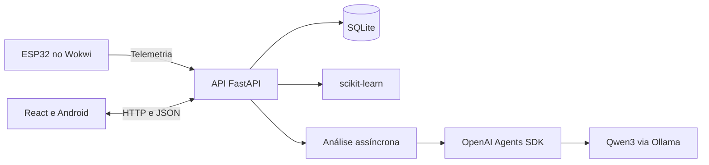

# CardioIA Fase 7

Projeto acadêmico em dupla para o tecnólogo em Inteligência Artificial da FIAP. O CardioIA recebe telemetria de um ESP32 simulado, executa um classificador de Machine Learning e usa agentes com um LLM local para explicar o resultado em um cenário de teste. Os dados e protocolos são sintéticos. A aplicação tem finalidade acadêmica e não se destina a uso clínico.

## Contribuições

- **Nicolas Antonio Silva Araujo** — integração do repositório, backend em Python e FastAPI, conexão do modelo e dos agentes com a API, firmware em MicroPython e documentação técnica.
- **Vitória Pereira Bagatin** — experiência visual e desenvolvimento dos clientes Web em React e Android em React Native com Expo.

O classificador e o fluxo de agentes foram desenvolvidos na Fase 6. Na Fase 7, a dupla integrou esses componentes à telemetria e às interfaces.

## Arquitetura

A API valida os dados do ESP32 e preserva as medições no histórico. Para entradas elegíveis, combina as leituras recentes com o contexto sintético e executa o classificador `StandardScaler + LogisticRegression`. O backend roda a análise por agentes em segundo plano para manter o painel responsivo.

O fluxo usa quatro papéis — orquestrador, analista, especialista em protocolos e planejador — com ferramentas e transferências explícitas entre agentes. O resultado segue um esquema validado. No assistente conversacional, as [instruções do LLM](Backend/data/conversa.json) delimitam o contexto que ele pode usar e a forma de explicar a saída do classificador. Veja também a [implementação dos agentes](Backend/src/cardioia/agents.py) e o [contrato da API](docs/contrato-api.md).

## Demonstração e validação

A [simulação do ESP32 no Wokwi](https://wokwi.com/projects/480345789543663617) mostra os sensores e o firmware. O simulador pode ser usado em modo local. Para executar a análise e a conversa, inicie o backend e o Ollama conforme o guia abaixo.

| Cenário sintético | Resultado observado na entrega |
| --- | --- |
| 26 °C e 81 BPM | A API aceitou a medição, calculou a classe experimental e concluiu a análise no Ollama. |
| 26 °C e 180 BPM | A API preservou a medição no histórico e informou `out_of_domain`, com classe e score nulos. |

A suíte do backend da entrega acadêmica registrou **105 testes aprovados**, incluindo regressões da Fase 6. Também foram validados o fluxo HTTP com o modelo e o Ollama em execução, a interface Web publicada e o cliente em um aparelho Android. Os [exemplos JSON](docs/exemplos/) são fixtures sintéticas para entender os formatos da API.

## Executar

- [Backend e IA](Backend/README.md) — Python, FastAPI, SQLite e Ollama.
- [Simulador IoT](IoT/README.md) — ESP32, DHT22, potenciômetro e MicroPython.
- [Web](Web/README.md) — React e Vite.
- [Android](Mobile/README.md) — React Native e Expo.
