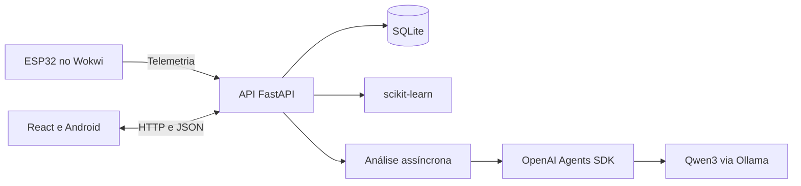
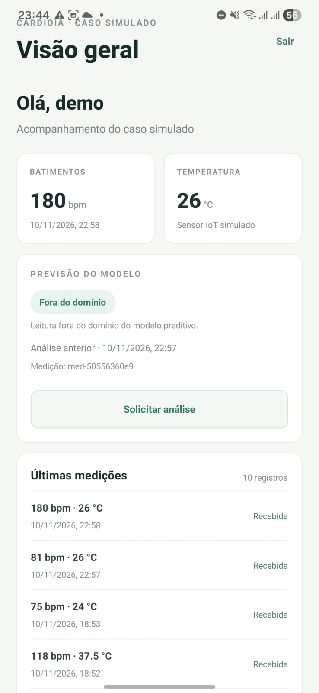
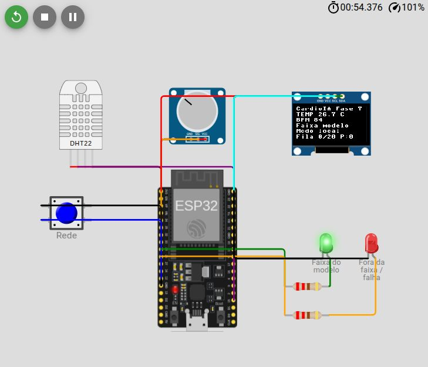

# CardioIA Fase 7

O CardioIA simula o acompanhamento de sinais cardíacos. Um circuito virtual gera leituras de temperatura e batimentos. Um serviço em Python recebe essas leituras, e os painéis web e Android exibem as medições e o resultado de um modelo de Machine Learning. Um assistente de IA ajuda a explicar o que aparece no painel.

Projeto acadêmico em dupla do tecnólogo em Inteligência Artificial da FIAP. Os dados e protocolos são sintéticos. A aplicação tem finalidade acadêmica e não se destina a uso clínico.

[Abrir simulador no Wokwi](https://wokwi.com/projects/480345789543663617) · [Ver demonstração e capturas](#demonstração-e-validação) · [Executar o projeto](#executar) · [Consultar o contrato da API](docs/contrato-api.md)

## Contribuições

- **Nicolas Antonio Silva Araujo** — integração do repositório, backend em Python e FastAPI, conexão do modelo e dos agentes com a API, firmware em MicroPython e documentação técnica.
- **Vitória Pereira Bagatin** — experiência visual e desenvolvimento dos clientes Web em React e Android em React Native com Expo.

O classificador e o fluxo de agentes foram desenvolvidos na Fase 6. Na Fase 7, a dupla integrou esses componentes à telemetria e às interfaces.

## Estrutura de arquivos

```text
cardioia-7-portfolio/
├── Backend/
│   ├── src/cardioia_api/  # API FastAPI, persistência e fila de análise
│   ├── src/cardioia/      # Classificador, agentes e integração com Ollama
│   ├── data/             # Dados sintéticos e instruções do assistente
│   ├── models/           # Modelo treinado, metadados e manifesto
│   ├── scripts/          # Configuração local e verificação da API
│   └── tests/            # Testes do backend e dos componentes de IA
├── IoT/                  # Firmware MicroPython e circuito do Wokwi
├── Mobile/               # Aplicativo Android em React Native e Expo
├── Web/                  # Painel web em React e Vite
├── docs/
│   ├── contrato-api.md   # Endpoints e formatos dos dados
│   ├── contratos/        # Schemas JSON
│   ├── exemplos/         # Exemplos sintéticos de entrada e saída
│   └── imagens/          # Capturas do Android e do Wokwi
├── .env.example          # Modelo de configuração local
└── README.md
```

## Arquitetura



A API valida os dados do ESP32 e preserva as medições no histórico. Para entradas elegíveis, combina as leituras recentes com o contexto sintético e executa o classificador `StandardScaler + LogisticRegression`. O backend roda a análise por agentes em segundo plano para manter o painel responsivo.

O fluxo usa quatro papéis — orquestrador, analista, especialista em protocolos e planejador — com ferramentas e transferências explícitas entre agentes. O resultado segue um esquema validado. No assistente conversacional, as [instruções do LLM](Backend/data/conversa.json) delimitam o contexto que ele pode usar e a forma de explicar a saída do classificador. Veja também a [implementação dos agentes](Backend/src/cardioia/agents.py) e o [contrato da API](docs/contrato-api.md).

## Demonstração e validação

Abra a [simulação do ESP32 no Wokwi](https://wokwi.com/projects/480345789543663617) e clique em **Start the simulation**. Gire o potenciômetro para mudar os batimentos e veja como o visor e os LEDs reagem. Você pode explorar o circuito no navegador, sem instalar nada.

Para também ver as medições no painel e experimentar a análise e a conversa com IA, siga o [guia do backend e do Ollama](Backend/README.md). Depois, escolha a interface [web](Web/README.md) ou [Android](Mobile/README.md).

| Painel no Android | Circuito no Wokwi |
| --- | --- |
|  |  |
| O painel mostra as medições simuladas, preserva o histórico e sinaliza quando o modelo não calcula uma previsão para a leitura. | O circuito simula temperatura e batimentos e indica, no visor e nos LEDs, se a leitura está na faixa do modelo. |

| Cenário sintético | Resultado observado na entrega |
| --- | --- |
| 26 °C e 81 BPM | A API aceitou a medição, calculou a classe experimental e concluiu a análise no Ollama. |
| 26 °C e 180 BPM | A API preservou a medição no histórico e informou `out_of_domain`, com classe e score nulos. |

A suíte do backend da entrega acadêmica registrou **105 testes aprovados**, incluindo regressões da Fase 6. Também foram validados o fluxo HTTP com o modelo e o Ollama em execução, a interface Web publicada e o cliente em um aparelho Android. Os [exemplos JSON](docs/exemplos/) são fixtures sintéticas para entender os formatos da API.

## Executar

Comece pelo backend e pelo Ollama. Depois, escolha uma interface ou conecte a simulação ao backend. Cada guia descreve sua parte da configuração.

- [Backend e IA](Backend/README.md) — Python, FastAPI, SQLite e Ollama.
- [Simulador IoT](IoT/README.md) — ESP32, DHT22, potenciômetro e MicroPython.
- [Web](Web/README.md) — React e Vite.
- [Android](Mobile/README.md) — React Native e Expo.
